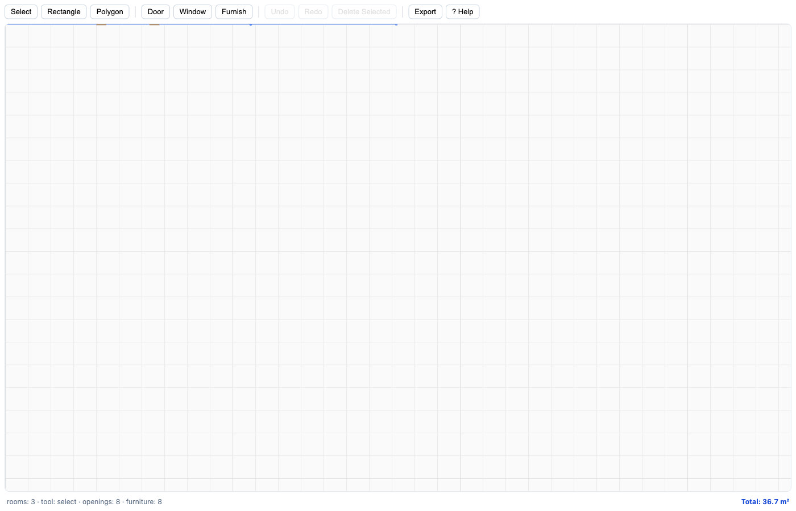
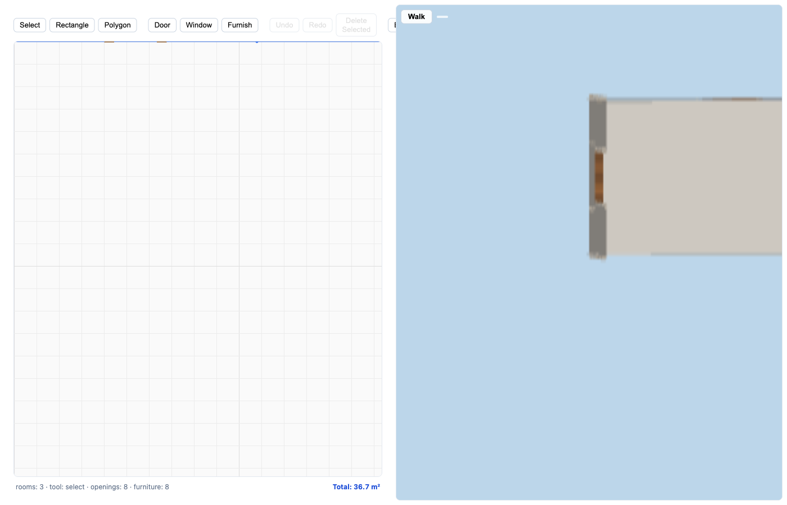

# 🏠 CasaPlazaIA — 2D/3D floorplanner

Draw an apartment in 2D, furnish it, then **walk through it in 3D** —
and export the plan as a PNG/JPEG image. Single-page web app, no
backend, no accounts; your plan autosaves to `localStorage`.



## Quick start (cold install)

Requirements: **Node ≥ 20** and npm.

```bash
git clone https://github.com/sv-tmueller/3d-casaplazai.git
cd 3d-casaplazai
npm install
npm run dev          # http://localhost:5173
```

Production build + preview:

```bash
npm run build
npm run preview      # serves dist/ (port 4173)
```

Pages served:

| Route     | What you get                                            |
| --------- | ------------------------------------------------------- |
| `/`       | 2D editor                                               |
| `/viewer` | 2D editor + 3D viewer side-by-side (shares your plan)   |

## Feature tour

### Drawing rooms (2D editor)

- **Rectangle tool** — drag on the canvas; corners snap to the 0.5 m
  grid and to neighboring room geometry (shared walls connect
  automatically).
- **Polygon tool** — click vertices, press `Enter` (or double-click /
  click near the start point) to close.
- **Select tool** — click a room to select; drag to move, drag a
  square handle to reshape. Red edges attract to foreign geometry.

### Doors & windows

Arm the Door or Window tool, hover a wall (it highlights yellow), then
click to place. Shared-wall doors placed on a common edge emit mirrored
pairs in one atomic, single-undo step.

### Furniture

Arm **Furnish**, pick a piece from the palette (bed, sofa, table,
chair, counter, bathtub, toilet), then click inside a room. Pieces are
constraint-checked: they must fit inside the room and not collide with
other furniture. Press `R` to rotate the selected piece 90°.

### Measurements

Every room shows an **area badge** (`Living Room: 19.4 m²`) at its
centroid, and the status bar shows the **livable-area total**
(`Total: 36.7 m²`). Overlapping rooms are counted twice in the total —
the editor warns about overlaps but does not prevent them.

### 3D viewer + walk mode

Open `/viewer` (or the bundled side-by-side page). The viewer compiles
your plan into meshes and offers:

- **Overview** orbit camera (drag to spin, wheel to zoom).
- **Walk mode** (`Tab` or the HUD toggle): WASD/arrows to move,
  mouse-look with pointer lock, `Shift` to sprint. You spawn inside the
  largest room at eye height and physically thread doorways —
  collision-safe, with doorway gaps carved out of the walls.

### Export

**Export** (toolbar) downloads your plan as an image: choose PNG or
JPEG and a 1×/2×/3× supersample scale. White background, measurement
badges baked in. File name: `floorplan-YYYY-MM-DD.{png,jpg}`.

## Controls & keyboard shortcuts

<!-- BEGIN SHORTCUTS -->
| Keys             | Action                                              |
| ---------------- | ---------------------------------------------------- |
| ?                | Show keyboard shortcuts                              |
| Esc              | Cancel current gesture / deselect                    |
| Enter            | Close polygon while drawing                          |
| Ctrl+Z           | Undo                                                 |
| Ctrl+Shift+Z     | Redo                                                 |
| Ctrl+Y           | Redo                                                 |
| R                | Rotate selected furniture 90°                        |
| S                | Toggle the Snapping settings popover                 |
| PageUp / [       | Switch to the floor below                            |
| PageDown / ]     | Switch to the floor above                           |
| Del / Backspace  | Delete selected room, opening, or furniture          |
| Alt+Drag / Middle-Drag | Pan the canvas                                 |
| Wheel            | Zoom at cursor                                       |
<!-- END SHORTCUTS -->

This table is kept in sync with `src/editor/shortcuts.ts` by
[`tests/unit/readme.shortcuts.sync.spec.ts`](tests/unit/readme.shortcuts.sync.spec.ts)
— edit the registry, rerun tests, paste the failing expectation. The
in-app cheat sheet (**?**) renders from the same registry.

Viewer keys: `Tab` toggles overview ⇄ walk; in walk mode use
`WASD`/arrows, mouse-look, `Shift` sprint, `Esc` to release the mouse.

## Development

```bash
npm run dev        # vite dev server (editor at /)
npm run verify     # lint + typecheck + vitest + Playwright journey (<3 min)
npm run verify:fast  # lint + typecheck + vitest only (rapid iteration)
npm run e2e        # Playwright suite alone (starts its own preview server)
```

Project layout:

```
src/
  shared/schema/   FloorplanData v1 contract + validation + migration
                   (see docs/schema.md)
  geom/            Dependency-light geometry kernel (triangulation,
                   connectivity, collision) — no DOM, no three.js
  editor/          2D editor: store (reducer + undo), controller,
                   render, openings/furniture, measures, export
  viewer/          3D viewer: scene builder, adapter, orbit/walk rigs,
                   spawn solver, HUD
demo/              Demo apartment fixture (also loads in-app via the
                   editor bridge)
e2e/               Playwright specs incl. the full-loop journey
tests/             Vitest unit suites (incl. the golden area sum)
```

Architecture details: [`docs/schema.md`](docs/schema.md).

## Screenshots

Regenerate `docs/img/readme-*.png` whenever the demo fixture changes —
the easiest way is exporting through the app itself (Export → PNG).




## Troubleshooting

- **Blank canvas after reload** — your autosave validated clean but
  empty; redraw or seed via the demo fixture.
- **“Headless” browsers fail to enter walk mode** — pointer lock is
  best-effort; keyboard movement still works.
- **Playwright can’t bind port 4199** — the e2e server uses
  `strictPort`; stop the stale process or unset `reuseExistingServer`
  expectations (`npm run e2e` kills its own server).
