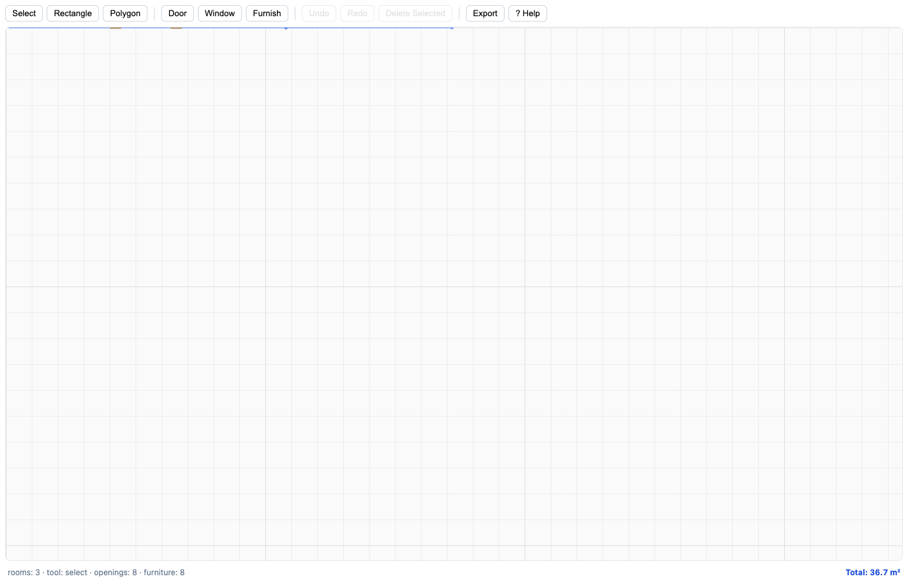
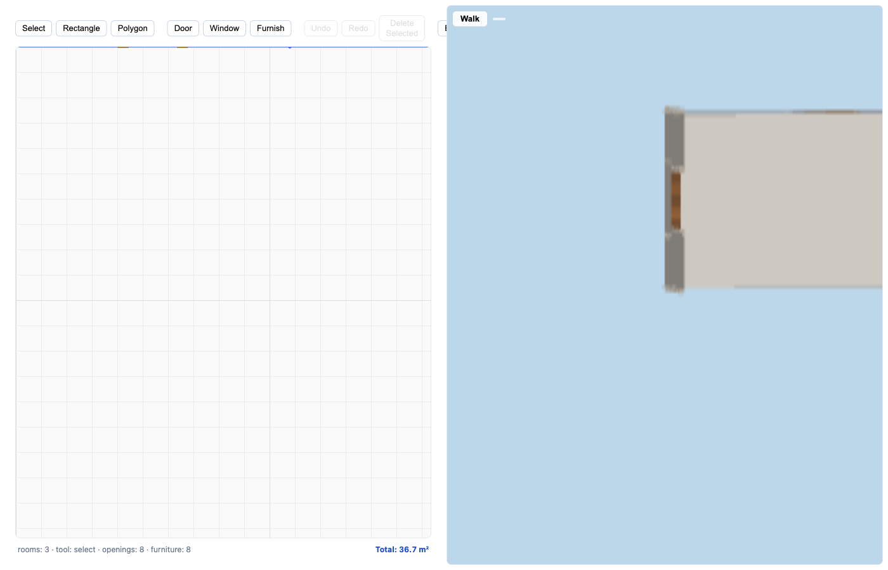

# 🏠 CasaPlazAI — 2D/3D floorplanner

Draw an apartment in 2D, furnish it, then **walk through it in 3D** —
and export the plan as a PNG/JPEG image. Single-page web app, no
backend, no accounts; your plan autosaves to `localStorage`.



## Quick start (cold install)

Requirements: **Node ≥ 20** and npm.

```bash
git clone https://github.com/sv-tmueller/3d-casaplazai.git
cd 3d-casaplazai
npm install
npm run dev          # http://localhost:5173
```

Production build + preview:

```bash
npm run build
npm run preview      # serves dist/ (port 4173)
```

Pages served:

| Route     | What you get                                                        |
| --------- | ------------------------------------------------------------------- |
| `/`       | The workspace: Plan, 3D and Walk views of one plan                  |
| `/viewer` | Redirects to `/?view=3d`, keeping its query and any `#plan=` link   |

The workspace has a top bar (file menu behind the logo, project name,
the **Plan / 3D / Walk** segment, the level stepper, undo/redo, share,
export, inspector, help, theme, fullscreen), a floating tool card on
the left (**Build**, **View** and **Measure** tabs), an inspector on the
right while something is selected, and a status bar (hint, cursor,
area total, zoom).

## Feature tour

### Drawing rooms (2D editor)

- **Rectangle tool** — drag on the canvas; corners snap to the 0.5 m
  grid and to neighboring room geometry (shared walls connect
  automatically).
- **Polygon tool** — click vertices, press `Enter` (or double-click /
  click near the start point) to close.
- **Select tool** — click a room to select; drag to move, drag a
  square handle to reshape. Red edges attract to foreign geometry.

### Doors & windows

Arm the Door or Window tool, hover a wall (it highlights yellow), then
click to place. Shared-wall doors placed on a common edge emit mirrored
pairs in one atomic, single-undo step.

### Furniture

Arm **Furniture** (`F`), pick a piece in the tool card (bed, sofa, table,
chair, counter, bathtub, toilet), then click inside a room. Pieces are
constraint-checked: they must fit inside the room and not collide with
other furniture. Press `R` to rotate the selected piece 90°.

### Measurements

Every room shows an **area badge** (`Living Room: 19.4 m²`) at its
centroid, and the status bar shows the **livable-area total**
(`Total: 36.7 m²`). Overlapping rooms are counted twice in the total —
the editor warns about overlaps but does not prevent them.

### 3D and Walk views

The **3D** view (`2` or the segment) shows the plan compiled into
meshes, framed after every change, as an orbit camera (drag to spin,
wheel to zoom). Roofs, ceilings, walls transparency, quality and the
sun live in the tool card's **View** tab.

The **Walk** view (`3`) is first person: click to walk, WASD/arrows to
move, mouse-look with pointer lock, `Shift` to sprint. You spawn where
you last stood (or inside the largest room) at eye height and
physically thread doorways — collision-safe, with doorway gaps carved
out of the walls. `Esc` releases the mouse and keeps you in Walk; `1`
or `2` (or the segment) leave it.

### Export

**Export** (top bar) downloads the active floor as an image: choose PNG or
JPEG and a 1×/2×/3× supersample scale. White background, measurement
badges baked in. File name: `floorplan-YYYY-MM-DD.{png,jpg}`.

## Controls & keyboard shortcuts

<!-- BEGIN SHORTCUTS -->
| Keys | Action |
| ---- | ------ |
| ? | Show keyboard shortcuts |
| Esc | Cancel current gesture / deselect |
| Enter | Close polygon while drawing |
| Ctrl+Z | Undo |
| Ctrl+Shift+Z | Redo |
| Ctrl+Y | Redo |
| V | Arm the Select tool |
| R | Arm Rectangle (rotates selected furniture 90° while one is selected) |
| P | Arm the Polygon tool |
| D | Arm the Door tool |
| W | Arm the Window tool |
| F | Arm the Furniture (stamp) tool |
| T | Arm the Stairs tool |
| M | Arm the Measure tool |
| S | Open the Build tab’s Snapping section |
| L | Set the selected room’s wall lean (roof) in the inspector |
| I | Toggle the inspector panel |
| 1 | Switch to the Plan view |
| 2 | Switch to the 3D view |
| 3 | Switch to the Walk view |
| C | Place the walk camera (click a room, drag to aim), then walk |
| PageUp / [ | Switch to the floor below |
| PageDown / ] | Switch to the floor above |
| Del / Backspace | Delete selected room, opening, or furniture |
| 0 | Fit the whole plan in the viewport |
| Space (hold) | Temporarily switch to the Pan tool |
| Drag on empty space | Marquee multi-select (bulk delete; bulk DRAG moves rooms and furniture — staircases stay put) |
| Alt+Drag / Middle-Drag | Pan the canvas |
| Wheel | Zoom at cursor |
<!-- END SHORTCUTS -->

This table is kept in sync with the command registry
(`src/app/commands.ts`, rows exported by `src/app/shortcuts.ts`) by
[`tests/unit/readme.shortcuts.sync.spec.ts`](tests/unit/readme.shortcuts.sync.spec.ts)
— edit the registry, rerun tests, paste the failing expectation. The
in-app cheat sheet (**?**) and every control's tooltip render from the
same registry.

## Accessibility

- **Keyboard**: every control is a named button, switch, slider or
  segment reachable with Tab; segments, tabs and menus move with the arrow
  keys; dialogs (export, shortcuts, confirm) keep Tab inside while open and
  hand focus back to the control that opened them. The canvas is
  Tab-focusable with a focus ring. A shortcut used mid-draw (`S`, `L`) never
  takes canvas focus, so Escape keeps its draw-gesture precedence. Plan keys
  are inert in the 3D and Walk views.
- **Screen readers**: notices are toasts in a polite live region
  (`role="status"`); errors announce assertively (`role="alert"`).
- **Reduce motion** (`prefers-reduced-motion: reduce`): every transition
  reads a duration token that drops to zero, so panel slides, the view
  veil, toast fades, the splash exit and the idle camera drift all stop.
  Nothing is removed functionally.
- **Contrast**: the measurement-pill text and outline are pinned against every
  editor backdrop by [`tests/unit/contrast.spec.ts`](tests/unit/contrast.spec.ts).

Walk keys: `WASD`/arrows, mouse-look, `Shift` sprint, `Esc` to release
the mouse (you stay in Walk), `1` / `2` to leave.

Walk navigation aids (issue #147): the room pill at the top of the Walk
view names the room the walker stands in on its storey (or `Outside`);
its menu, **Go to room**, teleports the walker to any room, switching
floors as needed. In the Plan view, **C** arms **Place camera** — click
inside a room to put the walker there, drag to aim it — and opens the
Walk view seated there without grabbing the mouse; `Esc` cancels. The
plan mirrors the walker as a glyph (orange dot + heading wedge) whenever
it is on the active floor, also after you leave Walk.

## Development

```bash
npm run dev        # vite dev server (workspace at /, component kit at /dev/kit.html)
npm run build      # e2e serves dist/: build before e2e / verify
npm run verify     # lint + typecheck + vitest + Playwright e2e (the gate)
npm run verify:fast  # lint + typecheck + vitest only (rapid iteration)
npm run e2e        # Playwright suite alone (serves the built dist/)
```

Project layout:

```
src/
  shared/schema/   FloorplanData v1 contract + validation + migration
                   (see docs/schema.md)
  geom/            Dependency-light geometry kernel (triangulation,
                   connectivity, collision) — no DOM, no three.js
  ui/              Component kit + design tokens (light/dark), no app
                   imports; showcase at /dev/kit.html
  app/             Workspace shell: AppState, command registry,
                   keyboard dispatcher, panels, dialogs, entry point
  editor/          2D model and canvas engine (behind EditorEngine):
                   store (reducer + undo), controller, render,
                   openings/furniture, measures, export
  viewer/          3D engine: scene builder, adapter, orbit/walk rigs,
                   spawn solver, UI sink
demo/              Demo apartment fixture (also loads in-app via the
                   editor bridge)
e2e/               Playwright specs incl. the full-loop journey
tests/             Vitest unit suites (incl. the golden area sum)
```

Architecture details: [`docs/schema.md`](docs/schema.md).

## Screenshots

Regenerate `docs/img/readme-*.png` whenever the demo fixture changes —
the easiest way is exporting through the app itself (Export → PNG).




## Troubleshooting

- **Blank canvas after reload** — your autosave validated clean but
  empty; redraw or seed via the demo fixture.
- **“Headless” browsers fail to enter walk mode** — pointer lock is
  best-effort; keyboard movement still works.
- **Playwright can’t bind port 4199** — the e2e server uses
  `strictPort`; stop the stale process or unset `reuseExistingServer`
  expectations (`npm run e2e` kills its own server).

## License

© 2026 Thomas Mueller. All rights reserved. Source shown for reference only.
